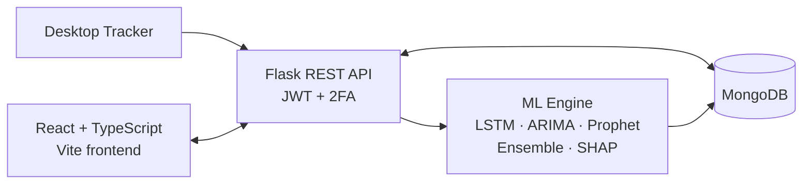

<div align="center">

# ⏱️ ChronosAI (FocusFlow): AI Productivity Intelligence Platform

**A full-stack productivity app that tracks how you work, forecasts your productivity with time-series ML, and explains its predictions with SHAP.**


</div>

> 🌐 **Live demo:** [chronosai-frontend.onrender.com](https://chronosai-frontend.onrender.com)
> ⏳ Hosted on Render's free tier. The backend sleeps when idle, so **the first load can take ~1 minute**; after that it's fast.

---

## 📌 Overview

Most productivity apps only log time. ChronosAI also models it. It combines **activity tracking, task management and focus sessions** with an ML layer that forecasts future productivity, detects procrastination and fatigue, measures context-switching cost, and explains every prediction.

## ✨ Features

**Product**
- 🔐 JWT authentication with bcrypt hashing and **TOTP two-factor login**
- ✅ Task manager, 🎯 focus mode (Pomodoro-style sessions), 👥 teams
- 📊 Analytics dashboard, reports, wellness view and an AI chatbot
- 🖥️ Desktop activity tracker (Windows) that logs app and window usage

**ML / Analytics** (`backend/ml/`)
| Module | Technique |
|---|---|
| `lstm_forecaster.py` | LSTM deep-learning productivity forecast |
| `arima_forecaster.py` | ARIMA / auto-ARIMA statistical forecast |
| `time_series_forecaster.py` | Prophet additive-regression forecast |
| `adaptive_ensemble.py` | Adaptive weighted ensemble of the forecasters, with a weight simulator |
| `productivity_classifier.py` | scikit-learn productivity-state classifier |
| `procrastination_detector.py` | Procrastination-pattern detection |
| `fatigue_index.py` | Fatigue index from session and activity patterns |
| `context_switch.py` | Context-switching cost analysis |
| `mood_productivity_var.py` | Vector autoregression of mood and productivity |
| `shap_explainer.py` | SHAP explanations for model outputs |

Model selection is documented in [`selection_of_model/`](selection_of_model): time-series plots, ADF stationarity tests, ACF/PACF analysis, and AIC/BIC model comparison.

## 🏗️ Architecture



## 🛠️ Tech Stack

| Layer | Tools |
|---|---|
| Frontend | React, TypeScript, Vite |
| Backend | Flask, Flask-CORS, PyJWT, bcrypt, pyotp, Gunicorn |
| Database | MongoDB (PyMongo) |
| ML | TensorFlow/Keras, statsmodels, pmdarima, Prophet, scikit-learn, SHAP |
| Deploy | Render Blueprint (API + static site) |

## 📁 Project Structure

```
├── components/            # React UI (Dashboard, FocusMode, MLInsights, NovelInsights, ...)
├── backend/
│   ├── app.py             # Flask entry point
│   ├── routes/            # auth, tasks, activities, focus, insights, novel, team, tracker
│   ├── ml/                # forecasting, classification and explainability modules
│   ├── models/            # MongoDB models
│   ├── train_all_models.py
│   └── seed.py            # demo data
├── selection_of_model/    # statistical model-selection study
└── render.yaml            # one-click deploy
```

## 🚀 Getting Started

**Backend**
```bash
cd backend
pip install -r requirements.txt
cp .env.example .env        # set MONGO_URI and JWT secret
python seed.py              # optional demo data
python train_all_models.py  # train the forecasting models
python app.py               # http://localhost:5000
```

**Frontend**
```bash
npm install
npm run dev                 # set VITE_API_URL if the API is not local
```

**Deploy:** create a Render **Blueprint** from this repo, enter `MONGO_URI`, and Render sets up both services from `render.yaml`.

## 🔌 Key API Endpoints

| Area | Endpoints |
|---|---|
| Auth | `POST /api/auth/register`, `POST /api/auth/login`, `GET /api/auth/profile` |
| Tasks | `GET/POST /api/tasks`, `PUT/DELETE /api/tasks/<id>` |
| Focus | `POST /api/focus/start`, `POST /api/focus/end`, `GET /api/focus/stats` |
| Insights | `GET /api/insights/dashboard`, `/forecast`, `/trends` |
| Novel ML | `GET /shap`, `/fatigue`, `/context-switch`, `/procrastination`, `/ensemble-weights` |

## 👩‍💻 Author

**Ghanasree S**: [GitHub](https://github.com/Ghanasree-S) · [LinkedIn](https://www.linkedin.com/in/ghanasree-s-88976b2b0)
